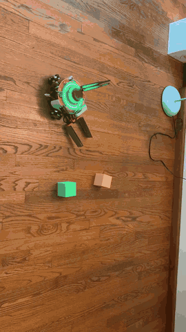

# Object Sorter

**A small mobile robot that finds colored blocks on the floor and pushes each one into its own corner — no human in the loop.**

<p align="center">
  
  <br>
  <sub>Demo (3× speed)</sub>
</p>

You tell the robot how big the play area is. It drives the outline of that rectangle to learn where the four corners are, then turns to face the middle and starts working: it spots a block with its camera, works out how far away it is and in which direction, drives over to it, and pushes it to the corner assigned to that block's color. Then it backs up, turns around, and looks for the next one.

## How it works

```
 RGB-D camera ──► YOLO (custom-trained) ──► pick most confident block
                                                │
             depth image ──► distance (m) ◄─────┤
           pixel offset  ──► turn angle (°) ◄───┘
                                                │
                     odometry (/tf) ──► rotate ──► drive forward ──► push to color's corner
                                                                          │
                                                       back up, turn around, repeat
```

1. **Map the space.** Given the area's width and height, the robot drives the perimeter and records each corner's position from odometry. Those corners become the sorting bins.
2. **See.** A YOLO model trained on our own photos of the blocks detects and tracks four classes — green, grey, purple and yellow cubes — in the camera feed. Detections under 80% confidence or without valid depth are ignored.
3. **Locate.** The aligned depth image gives the distance to the block. Its horizontal offset from the image center, combined with the camera's 69° field of view, gives the angle to turn.
4. **Act.** A proportional controller rotates the robot toward the block using odometry feedback, drives the measured distance, then turns toward the block's corner and pushes it there.
5. **Reset.** The robot backs up and turns around to face the center again, ready for the next block.

To build the training set quickly, we used YOLO-World to auto-label our photos before training the final detector (`scripts/labeling_preprocess.py`).

## Tech

- **Robot:** Triton mobile base with an Intel RealSense RGB-D camera
- **Software:** ROS Noetic, Python, OpenCV, Ultralytics YOLO (exported to ONNX)
- **Localization:** odometry from `/tf`

## Repository layout

```
object_sorter/
├── launch/
│   ├── object_sorter.launch   # main entry point; set the area's width/height here
│   └── random_walk.launch     # standalone exploration behavior
└── scripts/
    ├── perception.py          # camera → YOLO tracking → distance/angle → main loop
    ├── movement_odom.py       # perimeter mapping, rotate/drive/sort using odometry
    ├── random_walk.py         # random exploration behavior
    ├── labeling_preprocess.py # YOLO-World auto-labeling for the training set
    └── detector.py            # experimental TensorRT detector
```

## Setup

1. Copy the `object_sorter` package into your catkin workspace (`catkin_ws/src`).
2. Download the trained model (and, optionally, the dataset) from [Google Drive](https://drive.google.com/drive/folders/1c6dV42xMO3MF4OMLY3cvzJqUx-Qwl1d_?usp=sharing) and put `best.onnx` and `best.pt` in `catkin_ws/src/object_sorter`.
3. Set the `width` and `height` (in meters) of your area in `launch/object_sorter.launch`.
4. Attach an arm/pusher to the front of the robot base.
5. Place the robot with its center at the **bottom-right corner** of the area, camera facing the **top-right corner**.
6. Assign each color to a corner in `color_to_bin` in `scripts/movement_odom.py`. If your blocks differ, update `COLORS` in `scripts/perception.py` to match your model's classes.

### Dependencies

Python (via pip): `numpy`, `opencv-python`, `ultralytics`, `ros_numpy`, `cv_bridge`

ROS Noetic packages: `rospy`, `geometry_msgs`, `nav_msgs`, `sensor_msgs`, `std_msgs`, `tf`, `tf2_msgs`, `cv_bridge`

The package runs inside the Triton Noetic Docker container.

## Running

Inside the container:

```sh
cd catkin_ws
source devel/setup.bash
roslaunch object_sorter object_sorter.launch
```

The robot first traces the perimeter of the area (adjust `width`/`height` and relaunch if it's off), then lines up with the center and starts detecting, tracking and sorting blocks into their corners.

## Team

Built by Jiaqi Ye, Steve Cao, Hung Pham and Shravanthi Murugesan.
